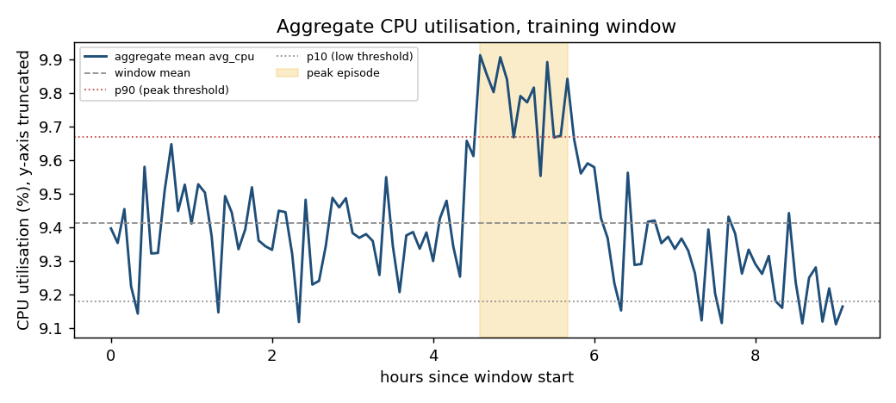
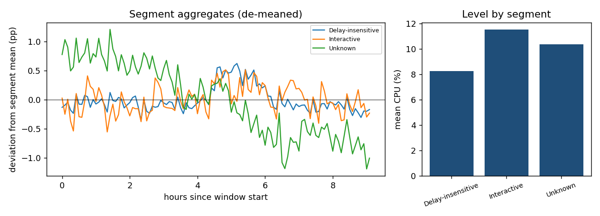
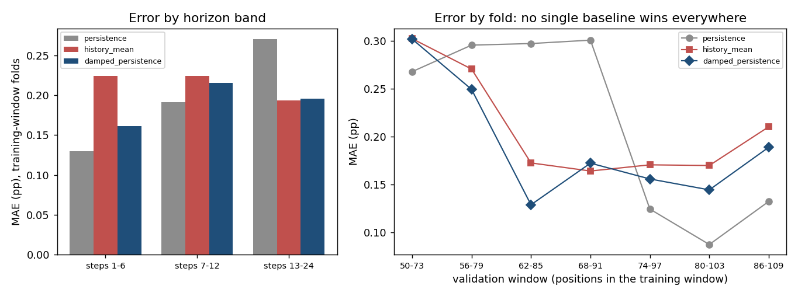
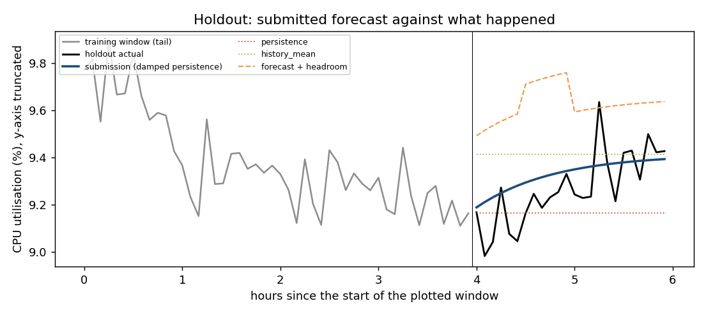

# Forecasting aggregate cloud workload: final report

All numbers below come from the code in this repository (`README.md` lists the commands).
Exploration, model choice and validation use only the first 110 of the 134 observations;
the final 24 were read once, after the model was frozen (§5).

## 1. Executive summary

**Task.** From 10,000 Azure VMs observed every five minutes for 11.2 hours, forecast two
aggregate series over the next 2 hours (24 steps): `active_vm_count` and
`aggregate_cpu_utilization` (the mean of the VMs' `avg_cpu`).

**What we found and did.**

- `active_vm_count` is not a forecasting problem in this release. Only VMs with complete
  traces were included, so no VM can appear or disappear inside the window: the count is
  10,000 at every timestamp. We forecast that constant, but only after proving from the
  training window plus VM metadata that it cannot change in the horizon.
- `aggregate_cpu_utilization` is very calm (std 0.19 percentage points, about 2% of its
  9.4% level), has no trend and no identifiable cycle in nine hours, and changes behaviour
  inside the window. We chose a deliberately simple model, **damped persistence**: the
  last value decays geometrically toward the history mean, with one parameter
  (`phi = 0.90`) estimated from the training window.

**Results.** On the one-shot holdout the submission has MAE 0.106 pp (RMSE 0.129,
sMAPE 1.14%) for the CPU series and is exact for the count. That is 28% lower MAE than
persistence (0.147) and 40% lower than the history mean (0.175). In rolling-origin
validation inside the training window it was 11% and 8% better than the same two
baselines (MAE 0.192 vs 0.215 and 0.209).

**How much to trust this.** The edge over baselines is real but modest and rests on 7
overlapping validation folds and 24 correlated holdout points. No single baseline wins
everywhere; the model's value is that it is never far behind the best one. The holdout was
a calmer stretch than the validation folds (MAE 0.106 is below every fold's 0.129 to 0.302),
so the absolute error should not be extrapolated. The holdout contained no peak
readings, so peak behaviour is judged on validation only, where the model under-reacts.

**Recommendation.** Provision `forecast + margin`, with a margin taken from the 90th
percentile of validation shortfalls (about 0.30 pp, 3% of the level). On the holdout
this cut under-provisioned intervals from 33% to 4% at the price of about 0.36 pp of idle
capacity (§8).

## 2. Data understanding and preprocessing

**Release.** `vm_cpu_readings`: 1,340,000 rows (10,000 VMs x 134 timestamps, 300 s apart);
`vm_metadata`: one row per VM. Timestamps are seconds from the start of the source trace,
so time of day and day of week are unknown.

**Cleaning rules (all counted and reported by `cwfc.targets`).** A reading is valid if its
timestamp, VM id and `avg_cpu` are present and finite and `avg_cpu` lies in [0, 100];
invalid rows are dropped *before* de-duplication so a bad duplicate cannot hide a good
one; duplicate `(vm, timestamp)` pairs keep the first row; off-grid timestamps raise
instead of being resampled; a timestamp with no valid reading is kept and flagged as a
gap, never interpolated. On this release the audit is clean: 0 invalid rows, 0 duplicates,
0 gaps, 0 readings with `avg_cpu` outside `[min_cpu, max_cpu]`, no `max_cpu` at 100.

**Targets.** `active_vm_count(t)` = number of distinct VMs with a valid reading at `t`;
`aggregate_cpu_utilization(t)` = mean of their `avg_cpu`. The full 134-point series is
built first and split afterwards.

**Why the count is constant.** The data card says only VMs with a complete 134-point
trace were selected, which is a selection on survival. The metadata agrees: all 10,000
VMs were created at the trace start (left-censored), 82.1% are still alive when the
source trace ends (about 30 days), and the earliest deletion is at 40,500 s, 600 s after
the last holdout timestamp. The check in `cwfc.population` requires, on the training
window and metadata only, that the count is constant, every VM has full coverage, the VM
sets match, and no VM is created after the window start or deleted before the horizon end.
A unit test covers the dangerous case: a VM that is alive throughout training but deleted
inside the horizon makes the constant forecast unsafe, and the code then refuses it.

**Leakage risk in the metadata.** `avg_cpu`, `max_cpu` and `p95_max_cpu` are statistics over
the VM's whole 30-day life, so they contain information from after any forecast origin.
They are descriptively useful (the window's per-VM means correlate 0.87 Pearson / 0.93
Spearman with them, and their mean, 9.34, is close to the window's 9.41) but
`cwfc.availability` forbids them, and the deletion time, as model inputs.

## 3. Workload analysis

(The y-axis is truncated; the peak is 5.3% above the mean.)

**Levels are skewed and persistent.** The median VM-interval uses 5.1% CPU but the mean is
9.4%; 49% of intervals are below 5%, 3.1% are at or above 50% and 1.3% at or above 80%
(p99 = 87%). The busiest 1% of VMs carry 9.6% of the load, the busiest 10% carry 43.5%.
84% of the pooled variance is *between* VMs, only 16% is within-VM change over time, and
VM rank is stable (Spearman 0.97 between the two halves of the window). *Operational
meaning:* the composition is almost fixed, so the aggregate level is anchored.

**The aggregate is calm because VMs diversify.** Its std (0.19 pp) is 3.3 times what 10,000
independent VMs would give (variance ratio 11), i.e. a mean pairwise correlation of 0.004,
equivalent to about 250 independent VMs. Peak and trough are only +5.3% and -3.2% from the mean. *Operational meaning:* pool-level headroom can be thin, but per-VM and per-tenant
risk is not: 1.7% of VM-intervals have `max_cpu` at or above 95%, and 1,518 intervals have
`avg_cpu` below 20% with `max_cpu` of 90% or more, spikes the five-minute average hides.

**Volatility is partly knowable in advance.** The 500 most volatile VMs in the first half
overlap 63% with the most volatile in the second half (5% by chance). An in-sample count
("the top 1% of VMs account for 46% of the variance") is inflated by selecting on the data
it describes; the honest out-of-sample version is that this 5% cohort (13% of the load)
contributes a std of 0.117 pp against 0.146 pp for the other 95%.

**Temporal structure is weak and not stationary.** No trend (R² 0.03); autocorrelation
0.66 at lag 1, below 0.2 from lag 11, AR(1) coefficient 0.67; the first difference has
autocorrelation -0.42 (noise around a smooth level). 51% of the detrended spectral power
sits in the two slowest frequencies: with nine hours of data a slow cycle cannot be told
from drift, and no daily or weekly pattern can be learned. There is one clear episode, steps
55 to 68 (about 70 minutes), holding all 11 readings above the window's 90th percentile;
low-demand readings are scattered isolated points. The dynamics also change: lag-1 level
autocorrelation is 0.06 in the first half of the window and 0.81 in the second.

**Segments move in different directions.** The episode comes from small VMs (2 cores: +0.57 pp; 4 and 8 cores: about 0), and the 729 `Unknown`-category VMs (7% of VMs)
drift down by 2.0 pp over the window, a weighted contribution of -0.15 pp that exceeds the
whole aggregate trend (-0.12 pp). Interactive VMs run hotter (11.5%) than delay-insensitive
ones (8.3%), mainly through a heavier tail. The load is spread over 2,324 subscriptions
(the largest holds under 1% of VMs). *Operational meaning:* the aggregate hides opposing
segment dynamics, and a segment-level forecaster is the natural extension (§9).

## 4. Forecasting approach

**CPU series: damped persistence.** With `m` the mean of the history, `y_T` the last value
and `phi` in (0, 1):

`forecast(h) = m + phi^h * (y_T - m)`, `h = 1..24`.

`phi` is chosen from a grid by minimising the mean absolute multi-step error *inside the
history*: for each origin `s` in the history and each `h`, the forecast built from
observations up to `s` only is compared with `y_{s+h}`. Persistence (`phi -> 1`) and the
history mean (`phi -> 0`) are its limits. On the full training window `phi = 0.90`.

**Why so simple.** The exploratory analysis shows what a model can and cannot learn here:
no trend, no cycle, fast short-term dependence, a regime change, and only 110 points.
Persistence wins in some validation folds and the history mean in others, so we use a model
that interpolates between them. A wider family that also smooths the level with an
exponential filter (`mean_reverting_level`, two parameters) was tried as an ablation and
lost (MAE 0.201 vs 0.192): with this little history the extra parameter fits noise. No
lagged-feature regression or calendar features were built: without a recurring pattern
there is nothing for them to capture, and the estimate of `phi` is already unstable across folds (0.50 to 0.90).

**Count series.** The proven constant (10,000) when the population check passes; otherwise
the last observed count, carried forward. The same fallback to persistence applies if the
training window has fewer than 12 points.

**Rejected inputs.** Metadata lifetime statistics (§2) and any VM-level feature that could
not be computed at the forecast origin.

## 5. Validation methodology

**Holdout.** The final 24 observations (2 hours, the forecasting horizon a capacity team
would plan against) are the holdout; the first 110 are training. The split is positional
and applied after the full series is built. The code hides holdout values behind a single
method, `reveal_holdout()`; a source scan in the tests enforces that it is called in exactly
one module, and the tests also run all modelling code with it patched to raise.

**Rolling origin inside the training window.** Expanding window, horizon 24, minimum
history 50, step 6: 7 folds with histories of 50, 56, ..., 86 points, the last validation
window ending exactly at the end of the training window. This mirrors production (refit on
everything seen so far, forecast the next 2 hours). Every parameter is estimated inside a
fold from that fold's history only, so the procedure is nested and no validation value ever
influences its own forecast.

**Safeguards (all tested).** Forecasters receive the history and a template that carries only
future timestamps, never target values; MASE scale and the peak threshold are computed from
the history; an independent brute-force re-implementation confirms the model's inner loss
uses prefixes only; deliberately injecting a leak (peeking at the holdout, or letting a
fold's history extend by 5 future points) makes tests fail.

**Selection rule.** Models were compared on pooled MAE and on *regret*: in each fold, the
model's MAE minus the best baseline's MAE in that fold. With a series whose behaviour
changes inside the window, the model that is never badly beaten is the robust choice.

**Caveats.** Neighbouring folds overlap, so fold errors are correlated and 7 folds are far
fewer than 7 independent trials; per-step errors rest on one origin per fold and are noisy.
The protocol was frozen before the holdout was read: a manifest with the SHA-256 of
`predictions.csv` and of the source tree was written first, and regenerating the file
afterwards reproduced the same hash. Two small edits were made to the code after the holdout was read, both outside the modelling path: `predict.py` now accepts the readings file as well as the directory for `--data`, and `eda.py` computes Spearman correlation without an undeclared `scipy` dependency (found by installing into a clean environment). Neither changes any forecast or any number in this report (the `predictions.csv` hash and all re-run results are unchanged), but it means the source-tree hash in the manifest no longer matches the final tree.

## 6. Results versus baseline

**Rolling-origin validation (training window, 7 folds), `aggregate_cpu_utilization`.**

| model | MAE | RMSE | bias | MAE / persistence | mean regret | worst-fold regret |
|---|---|---|---|---|---|---|
| **damped persistence** | **0.192** | **0.230** | +0.018 | 0.89 | **0.034** | 0.087 |
| mean-reverting level (ablation) | 0.201 | 0.240 | +0.034 | 0.93 | 0.043 | 0.086 |
| history mean | 0.209 | 0.245 | +0.008 | 0.97 | 0.051 | 0.109 |
| persistence | 0.215 | 0.272 | +0.121 | 1.00 | 0.057 | 0.137 |
| best moving average (3) | 0.229 | 0.279 | +0.119 | 1.06 | 0.070 | 0.202 |
| seasonal naive (24 steps) | 0.318 | 0.358 | +0.095 | 1.48 | 0.160 | 0.235 |

Regret is measured against the best of ten baselines in each fold. No model beats all
baselines in more than 1 of 7 folds; persistence is poor in the folds that contain the episode (MAE 0.27 to 0.30) and good afterwards (0.09 to 0.13), the history mean is steady
but never best, and damped persistence sits between them.

| MAE by horizon band | steps 1-6 | steps 7-12 | steps 13-24 |
|---|---|---|---|
| persistence | **0.130** | **0.191** | 0.270 |
| history mean | 0.224 | 0.224 | **0.193** |
| damped persistence | 0.161 | 0.215 | 0.195 |

**Holdout (one-shot, the submitted `predictions.csv` itself).**

| | MAE | RMSE | sMAPE | bias | MASE |
|---|---|---|---|---|---|
| `aggregate_cpu_utilization`: submission | **0.106** | **0.129** | 1.14% | +0.059 | 0.87 |
| persistence | 0.147 | 0.185 | 1.59% | -0.104 | 1.21 |
| history mean | 0.175 | 0.211 | 1.88% | +0.145 | 1.44 |
| `active_vm_count`: submission | 0 | 0 | 0 | 0 | n/a |

MASE uses the training window's one-step naive error as scale; relative improvement over a
baseline is undefined for `active_vm_count` because the reference is already exact.

## 7. Error and failure analysis

(The y-axis is truncated. The dashed line is forecast plus the §8 margin.)

**Where the model loses.** At short horizons it is worse than plain persistence, on the
holdout as in validation: MAE 0.148 vs 0.103 for steps 1-6 and 0.085 vs 0.072 for steps
7-12. Its advantage comes entirely from steps 13-24 (0.095 vs 0.206), where persistence has
drifted away from the level the series settles at. The model is a hedge, not a uniformly
better forecaster.

**Why: reversion toward a level the series did not return to.** The last training value was
9.17 while the history mean was 9.41, so the forecast climbs from 9.19 to 9.39. The
holdout stayed low (mean 9.27); the forecast was too high in 16 of 24 steps, bias +0.059.
Four holdout readings (8.98 to 9.08) fell below the training minimum of 9.11, a range the
history had not seen. The two largest over-forecasts, +0.23 at steps 2 and 6, are this
effect. The largest under-forecast, -0.27 at step 16, is a single spike to 9.64 that no
smooth forecaster would anticipate.

**Peaks.** No holdout reading reached the training window's 90th percentile (9.67; the
maximum was 9.64), so peak performance cannot be judged on the holdout. In validation
(45 peak readings across folds) the damped model's MAE on peaks is 0.300, worse than
persistence (0.225) and better than the history mean (0.337): damping toward the mean makes
it under-react when demand is high. This is the weakness that matters most for capacity
planning, and it is what the headroom margin in §8 partly covers.

**Why the holdout error looks better than validation.** The holdout range (8.98 to 9.64,
0.65 pp) is narrower than the training window's (9.11 to 9.91, 0.80 pp) and contains no
episode of the kind that hurt the early folds. Its MAE of 0.106 is below the best fold (0.129)
and well below the fold average (0.192). Relative comparisons (28% and 40% below the
baselines) are more informative than the absolute figure.

**Unstable parameter.** `phi` selected per fold ranged from 0.50 to 0.90 (0.50, 0.50, 0.80,
0.90, 0.90, 0.85, 0.85). In the first two folds it sits on the lower edge of the search grid:
the early history behaves almost like white noise (lag-1 autocorrelation 0.06), so the fit
wanted to revert to the mean faster than the grid allows, while the later part is strongly
persistent (0.81). The final value (0.90) is the highest of the per-fold values and reflects
the persistent second half; with only the earlier regime it would have been much lower. The
grid floor never constrained the final fit, but it is evidence that a single `phi` is a
compromise between two regimes.

**Percentage errors and near-zero denominators.** sMAPE here keeps a small `eps` in the
denominator, so a 0/0 pair scores 0 rather than NaN. It never matters in practice: the CPU
series is near 9% and the count near 10,000.

## 8. Capacity-planning recommendation

**Policy.** For each forecast step, provision `forecast(h) + margin(h)`. The margin is the
90th percentile of how far the actual value exceeded the forecast in the validation folds,
estimated per horizon band (`cwfc.policy`): 0.30 pp for steps 1-6, 0.42 for 7-12 and 0.24 for
13-24, 0.30 pp on average, or 3.2% of the 9.4% level. The non-monotone shape is estimation
noise from 7 folds; a single margin of about 0.30 pp is an equally defensible simplification.

**The trade-off.** A larger margin means fewer intervals with too little capacity but more
capacity sitting idle.

| margin quantile | mean margin (pp) | intervals short (validation folds) | mean surplus (pp) |
|---|---|---|---|
| none (median) | 0.00 | 35% | 0.11 |
| 80th | 0.20 | 21% | 0.25 |
| **90th** | **0.30** | **11%** | **0.33** |
| 95th | 0.40 | 7% | 0.43 |

(In-sample on the validation folds, hence optimistic.) On the holdout, with the 90th
percentile fixed in advance: with the margin 1 of 24 intervals fell short (4%, by 0.02 pp)
with a mean surplus of 0.36 pp; without it 8 of 24 (33%, by 0.07 pp on average) with
surplus 0.08 pp. A team that treats a shortfall as many times more costly than idle capacity
should pick a higher quantile; one that pays mainly for idle capacity should pick a lower
one. The choice is a cost ratio, not something the data can settle.

**Caveats for the infrastructure team.** (1) The margin is tiny in absolute terms because
the aggregate is so smooth; it protects *pool* capacity, not individual VMs or tenants,
where bursts and a hot tail (§3) dominate the risk. (2) Refit the model at every new
interval: it takes milliseconds. (3) Proposed, not tested here: if actual usage exceeds
`forecast + margin` for three consecutive intervals, treat it as a regime change and switch
to persistence for the next hour, since the damped forecast reacts slowly to level shifts.

## 9. Limitations and future work

- **One nine-hour window.** No daily or weekly seasonality can be estimated, and time of day
  is unknown. Conclusions about recurring patterns are absent, not negative.
- **Survivorship.** The release only contains VMs alive for the whole window, so
  arrivals, departures and churn, which drive real capacity risk, are invisible, and
  `active_vm_count` carries no information.
- **Small evidence base.** 7 overlapping folds and 24 correlated holdout points support a
  "consistent and robust" claim, not "significantly better". The margin estimate and the
  `phi` estimate both have visible uncertainty.
- **Regime change.** The behaviour in the first and second half of the window differs;
  a model that detects and adapts to such shifts (change-point detection, adaptive `phi`)
  is the most promising improvement.
- **Peak under-reaction** (§7) is a known weakness.
- **Not done, for time:** segment-level forecasts (the category, size and tenant structure in
  §3 suggests opposing dynamics worth modelling), an additional operationally motivated target
  such as the share of VMs reaching 95% `max_cpu` (the most variable and most predictable
  candidate we examined: CV 19%, lag-1 autocorrelation 0.86), probabilistic forecasts
  (quantile or conformal intervals instead of a margin) and exploratory notebooks.
